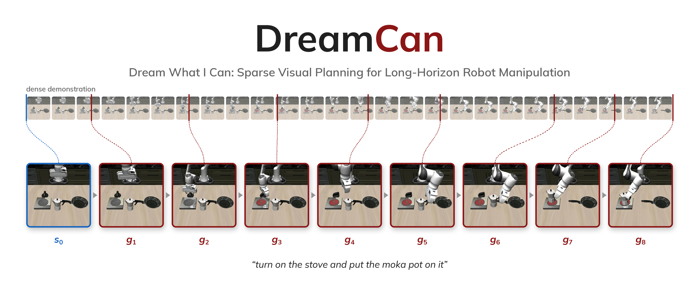

<p align="center">
  
</p>

<p align="center">
  <a href="http://arxiv.org/abs/2610.24981"></a>
  <a href="https://dreamcan.github.io/"></a>
</p>

## Installation

```bash
conda create -n dreamcan python=3.10 -y
conda activate dreamcan
pip install -r requirements.txt
pip install -e .
```

[LIBERO](https://github.com/Lifelong-Robot-Learning/LIBERO) (simulation and evaluation):

```bash
git clone https://github.com/Lifelong-Robot-Learning/LIBERO.git
pip install -e LIBERO
```

[DiffSynth-Studio](https://github.com/modelscope/DiffSynth-Studio) (Wan2.2):

```bash
git clone https://github.com/modelscope/DiffSynth-Studio.git
cd DiffSynth-Studio && git checkout d799831 && git apply ../patches/diffsynth_clean_frame_mask.patch && pip install -e . && cd ..
export DIFFSYNTH_ROOT=$(pwd)/DiffSynth-Studio
```

Push-T simulation:

```bash
pip install pygame pymunk==6.2.1 shapely opencv-python-headless
```

Language-Table ([SAM2](https://github.com/facebookresearch/sam2) block tracking, Qwen3 instruction embeddings):

```bash
git clone https://github.com/facebookresearch/sam2.git
cd sam2 && git checkout 2b90b9f && pip install -e . && cd ..
wget -P sam2/checkpoints https://dl.fbaipublicfiles.com/segment_anything_2/092824/sam2.1_hiera_large.pt
pip install opencv-python decord transformers
```

[RoboMeter](https://github.com/robometer/robometer) is only needed to recompute task progress, and
[CLIP](https://github.com/openai/CLIP) with the [DecisionNCE](https://github.com/2toinf/DecisionNCE)-T checkpoint
only to recompute instruction embeddings.

## Data and models

```bash
huggingface-cli download ChongkaiGao/DreamCan_Dataset --repo-type dataset --local-dir data
huggingface-cli download ChongkaiGao/DreamCan_Models --local-dir checkpoints
huggingface-cli download Wan-AI/Wan2.2-TI2V-5B --local-dir checkpoints/Wan2.2-TI2V-5B
```

Add `--include "libero_long/*"`, `--include "pusht/*"` or `--include "language_table/*"` to fetch a single task.

| File | Content |
| --- | --- |
| `data/libero_long/LIBERO_Long.h5` | 379 demonstrations, 256x256 agent-view and wrist images, actions, proprioception |
| `data/libero_long/LIBERO_Long_stats.json` | normalization statistics |
| `data/libero_long/instructions_decisionnce.npz` | DecisionNCE-T instruction embeddings |
| `data/libero_long/value_pairs/` | pairwise goal-conditioned values `V(s_i, s_j)` per episode |
| `data/libero_long/progress.json` | per-frame task progress |
| `data/libero_long/subgoals.json` | subgoal timesteps per episode |
| `checkpoints/libero_long/wan_lora.safetensors` | Wan2.2-TI2V-5B subgoal LoRA |
| `checkpoints/libero_long/policy.pt` | goal-conditioned policy |
| `data/pusht/PushT.h5` | 206 demonstrations, 96x96 images, actions, block and agent state |
| `data/pusht/PushT_stats.json` | normalization statistics |
| `data/pusht/value_pairs/` | pairwise goal-conditioned values `V(s_i, s_j)` per episode |
| `data/pusht/progress.json` | per-frame task progress |
| `data/pusht/subgoals.json` | subgoal timesteps per episode |
| `checkpoints/pusht/wan_lora.safetensors` | Wan2.2-TI2V-5B subgoal LoRA |
| `checkpoints/pusht/policy.pt` | goal-conditioned policy |
| `data/language_table/<task>/videos/` | `line` (1424), `all_to_region` (1303) and `canonical_shape` (1378) videos, 320x180, static frames removed |
| `data/language_table/<task>/episodes.json` | instruction per episode |
| `data/language_table/<task>/splits.json` | test episodes and threshold-calibration episodes |
| `data/language_table/<task>/detections/` | per-frame SAM2 block tracks |
| `data/language_table/<task>/value_pairs/` | pairwise goal-conditioned values `V(s_i, s_j)` per episode |
| `data/language_table/<task>/progress.json` | per-frame task progress |
| `data/language_table/<task>/subgoals.json` | subgoal timesteps per episode |
| `checkpoints/language_table/<task>/wan_lora.safetensors` | Wan2.2-TI2V-5B subgoal LoRA |

## LIBERO-Long

### 1. Goal-conditioned value function

```bash
python scripts/extract_radio_features.py --data data/libero_long/LIBERO_Long.h5 \
  --out data/libero_long/radio_b.h5 --radio c-radio_v3-b --views image

accelerate launch --num_processes 4 --multi_gpu scripts/train_value.py --config configs/libero_long/value.yaml

python scripts/compute_value_pairs.py --data data/libero_long/LIBERO_Long.h5 \
  --features data/libero_long/radio_b.h5 --checkpoint checkpoints/libero_long/value/value_060000.pt \
  --out data/libero_long/value_pairs
```

### 2. Task progress

```bash
python scripts/compute_progress.py --data data/libero_long/LIBERO_Long.h5 \
  --robometer_repo /path/to/robometer --out data/libero_long/progress.json
```

### 3. Subgoal annotation

```bash
python scripts/annotate_subgoals.py --data data/libero_long/LIBERO_Long.h5 \
  --value_pairs data/libero_long/value_pairs --progress data/libero_long/progress.json \
  --out data/libero_long/subgoals.json
```

### 4. Wan2.2 subgoal LoRA

```bash
accelerate launch --num_processes 8 --multi_gpu scripts/train_wan_lora.py \
  --data data/libero_long/LIBERO_Long.h5 --subgoals data/libero_long/subgoals.json \
  --wan_root checkpoints/Wan2.2-TI2V-5B --output_dir checkpoints/libero_long/wan_lora
```

### 5. Goal-conditioned policy

```bash
python scripts/encode_instructions.py --data data/libero_long/LIBERO_Long.h5 \
  --checkpoint /path/to/DecisionNCE-T.pth --out data/libero_long/instructions_decisionnce.npz

python scripts/extract_radio_features.py --data data/libero_long/LIBERO_Long.h5 \
  --out data/libero_long/radio_h.h5 --radio c-radio_v3-h --views image wrist_image

python scripts/generate_subgoal_features.py --data data/libero_long/LIBERO_Long.h5 \
  --wan_root checkpoints/Wan2.2-TI2V-5B --lora checkpoints/libero_long/wan_lora.safetensors \
  --out data/libero_long/subgoal_features --gpus 0,1,2,3,4,5,6,7

torchrun --standalone --nproc_per_node 8 scripts/train_policy.py --config configs/libero_long/policy.yaml
```

### 6. Evaluation

```bash
python scripts/eval_libero.py --checkpoint checkpoints/libero_long/policy.pt \
  --lora checkpoints/libero_long/wan_lora.safetensors --wan_root checkpoints/Wan2.2-TI2V-5B \
  --out_dir eval/libero_long --gpus 0,1,2,3,4,5,6,7
```

## Push-T

`data/pusht/progress.json` holds per-frame task progress from RoboMeter-4B fine-tuned on the Push-T demonstrations.

### 1. Goal-conditioned value function

```bash
python scripts/extract_radio_features.py --data data/pusht/PushT.h5 \
  --out data/pusht/radio_b_96.h5 --radio c-radio_v3-b --views image --size 96

accelerate launch --num_processes 4 --multi_gpu scripts/train_value.py --config configs/pusht/value.yaml

python scripts/compute_value_pairs.py --data data/pusht/PushT.h5 \
  --features data/pusht/radio_b_96.h5 --checkpoint checkpoints/pusht/value/value_010000.pt \
  --out data/pusht/value_pairs
```

### 2. Subgoal annotation

```bash
python scripts/annotate_subgoals.py --data data/pusht/PushT.h5 \
  --value_pairs data/pusht/value_pairs --progress data/pusht/progress.json \
  --num_subgoals 3 --out data/pusht/subgoals.json
```

### 3. Wan2.2 subgoal LoRA

```bash
accelerate launch --num_processes 8 --multi_gpu scripts/train_wan_lora.py \
  --data data/pusht/PushT.h5 --subgoals data/pusht/subgoals.json \
  --wan_root checkpoints/Wan2.2-TI2V-5B --output_dir checkpoints/pusht/wan_lora \
  --num_subgoals 4 --size 256 --prompt_dropout 0.5 --max_steps 68500
```

### 4. Goal-conditioned policy

```bash
python scripts/extract_radio_features.py --data data/pusht/PushT.h5 \
  --out data/pusht/radio_h_96.h5 --radio c-radio_v3-h --views image image --size 96

python scripts/generate_subgoal_features.py --data data/pusht/PushT.h5 \
  --wan_root checkpoints/Wan2.2-TI2V-5B --lora checkpoints/pusht/wan_lora.safetensors \
  --out data/pusht/subgoal_features --size 96 --num_subgoals 4 --goal_len 3 --gpus 0,1,2,3,4,5,6,7

torchrun --standalone --nproc_per_node 8 scripts/train_policy.py --config configs/pusht/policy.yaml
```

### 5. Evaluation

```bash
python scripts/eval_pusht.py --checkpoint checkpoints/pusht/policy.pt \
  --lora checkpoints/pusht/wan_lora.safetensors --wan_root checkpoints/Wan2.2-TI2V-5B \
  --out_dir eval/pusht --gpus 0,1,2,3,4,5,6,7
```

## Language-Table

The three Language-Table tasks are video-only, so plans are evaluated directly: a plan succeeds if its last subgoals
reach the instructed arrangement, all blocks stay intact, and no block jumps between subgoals.

```bash
TASK=line
D=data/language_table/$TASK
```

`TASK` is one of `line`, `all_to_region`, `canonical_shape`.

### 1. Block tracking and task progress

```bash
python scripts/language_table/detect_blocks.py --videos $D/videos --out $D/detections \
  --sam2_checkpoint sam2/checkpoints/sam2.1_hiera_large.pt --gpus 0,1,2,3,4,5,6,7

python scripts/language_table/compute_progress.py --task $TASK --detections $D/detections \
  --episodes $D/episodes.json --out $D/progress.json --workers 32
```

### 2. Goal-conditioned value function

```bash
python scripts/language_table/extract_features.py --data $D --out $D/radio_h.h5

accelerate launch --num_processes 8 --multi_gpu scripts/language_table/train_value.py \
  --config configs/language_table/value.yaml --task $TASK

python scripts/language_table/compute_value_pairs.py --features $D/radio_h.h5 \
  --checkpoint checkpoints/language_table/$TASK/value/value_097500.pt --out $D/value_pairs
```

### 3. Subgoal annotation

```bash
python scripts/language_table/annotate_subgoals.py --value_pairs $D/value_pairs \
  --progress $D/progress.json --out $D/subgoals.json
```

### 4. Wan2.2 subgoal LoRA

```bash
LORA="accelerate launch --num_processes 8 --multi_gpu scripts/language_table/train_wan_lora.py \
  --data $D --subgoals $D/subgoals.json --wan_root checkpoints/Wan2.2-TI2V-5B"
W=checkpoints/language_table/$TASK
```

`line`:

```bash
$LORA --output_dir $W/wan_stage1 --anchor_p_plain 1.0 --lr 1e-4 --max_steps 142400
$LORA --output_dir $W/wan_lora --init_lora $W/wan_stage1/lora_0142400.safetensors --lr 5e-5 --max_steps 53400
```

`all_to_region`:

```bash
$LORA --output_dir $W/wan_stage1 --anchor_p_plain 1.0 --lr 1e-4 --max_steps 76500
$LORA --output_dir $W/wan_lora --init_lora $W/wan_stage1/lora_0076500.safetensors --lr 5e-5 --max_steps 548900
```

`canonical_shape`:

```bash
$LORA --output_dir $W/wan_lora --lr 1e-4 --max_steps 638400
```

### 5. Evaluation

```bash
E=eval/language_table/$TASK

python scripts/language_table/generate_plans.py --data $D --out $E/plans \
  --lora $W/wan_lora.safetensors --wan_root checkpoints/Wan2.2-TI2V-5B --gpus 0,1,2,3,4,5,6,7

python scripts/language_table/detect_blocks.py --videos $E/plans --out $E/detections \
  --sam2_checkpoint sam2/checkpoints/sam2.1_hiera_large.pt --gpus 0,1,2,3,4,5,6,7

python scripts/language_table/eval_plans.py --task $TASK --data $D --detections $E/detections \
  --thresholds configs/language_table/thresholds/$TASK.json --out $E/results.json
```

The success thresholds are quantiles of the same metrics on ground-truth subgoal plans of the calibration episodes:

```bash
python scripts/language_table/generate_plans.py --data $D --out $E/gt_plans --split calibration --subgoals $D/subgoals.json

python scripts/language_table/detect_blocks.py --videos $E/gt_plans --out $E/gt_detections \
  --sam2_checkpoint sam2/checkpoints/sam2.1_hiera_large.pt --gpus 0,1,2,3,4,5,6,7

python scripts/language_table/eval_plans.py --task $TASK --data $D --detections $E/gt_detections \
  --calibrate configs/language_table/thresholds/$TASK.json
```
